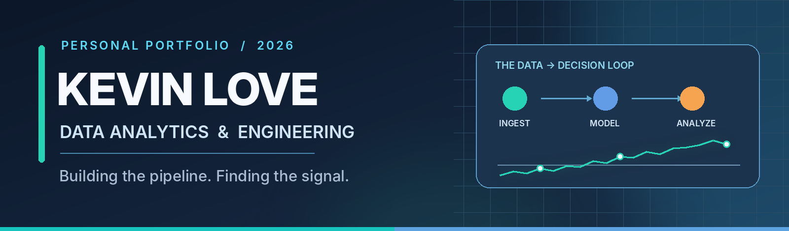
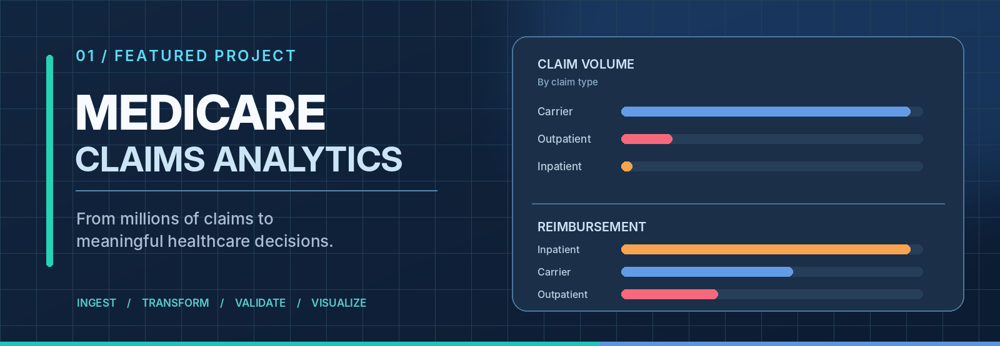

  

### Hi, I'm Kevin.

I'm a data analytics and engineering professional with **10+ years of experience** building data solutions, leading analytics teams, and turning complex information into business decisions. I enjoy working across the entire data lifecycle—from engineering pipelines and models to turning data into actionable insights.

---

## Selected Work

### Medicare Claims Analytics

An end-to-end healthcare analytics project built on synthetic Medicare claims data. I developed the ingestion pipeline, data warehouse, transformation and testing layers, and interactive dashboards. Then I used the data to investigate spending concentration, chronic conditions, and potential care-management opportunities.

**The goal:** Demonstrate not just how to build a reliable analytics solution, but how to turn it into a meaningful business conversation.

**[Explore the code & methodology](https://github.com/Klove778/Kevin_Love_Data_Analytics_and_Engineering)** &nbsp;·&nbsp; **[Open the interactive Tableau dashboards](https://public.tableau.com/app/profile/kevin.love3952/viz/MedicarePopulationHealthCostAnalysis/ExecutiveOverview)**

---

## Let's Connect

**[LinkedIn](https://www.linkedin.com/in/kevin-l-a50a1833/)** &nbsp;·&nbsp; **[GitHub](https://github.com/Klove778)**

More projects to come.
